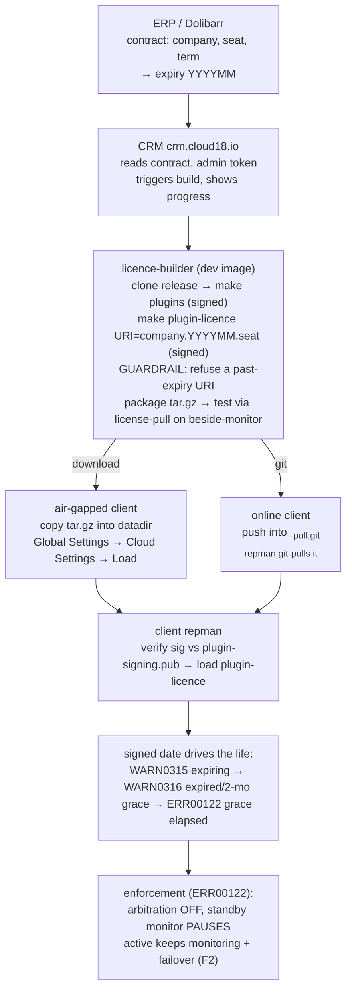

# Cloud18 licence flow — ERP → CRM → licence-builder → repman (#2309)

How a client's support contract becomes a signed licence their replication-manager loads, and how
that licence then governs the instance over its life. This is the end-to-end picture; the pieces are
detailed in [`LICENSE_BUILDER.md`](LICENSE_BUILDER.md) (the build),
[`../server/LICENSE_PULL.md`](../server/LICENSE_PULL.md) (the load) and
[`../cloud18/OFFLINE_LICENSE.md`](../cloud18/OFFLINE_LICENSE.md) (the offline licence file).

## Who owns what

| Stage | System | Owns |
|---|---|---|
| **ERP** | Dolibarr | the **contract**: the client's company code, seat count, and the **term** (start + length → an expiry month). The single source of truth for *who* is licensed and *until when*. |
| **CRM** | crm.cloud18.io | reads the contract, triggers a build per seat (with a `signal18-admin` Cloud18 token), and shows build progress. No API-only step — the GUI drives it. |
| **licence-builder** | `replication-manager-pro license-builder`, on the dev image beside a monitor | builds + **signs** the seat's package and **tests** it by loading it on the beside-monitor before hand-off. |
| **repman** | the client's replication-manager | loads the signed `plugin-licence`; from then on the **baked-in date** alone drives warnings and enforcement. |

The expiry lives in exactly one place the client cannot forge: the **signed `plugin-licence` binary**
(URI `<company>.<YYYYMM>.<seat>`, the ed25519 signature covers the whole binary). Not the ERP record
(that is our bookkeeping), not a config key (client-editable), not a hex-editable field (breaks the
signature → the plugin is refused).

## The graph



ASCII, the same flow:

```
  ERP / Dolibarr            CRM (crm.cloud18.io)         licence-builder                 client repman
  ---------------          --------------------         ----------------                 -------------
  contract:          ---->  reads contract;       ---->  per seat:                 --+
   company, seat,            admin token triggers         clone release              |
   term -> expiry            the build; shows             make plugins   (signed)    |
   YYYYMM                    progress                     make plugin-licence        |
                                                           URI=company.YYYYMM.seat   |
                                                           (signed; guardrail        |
                                                            REFUSES a past expiry)   |
                                                          package tar.gz             |
                                                          test: license-pull on      |
                                                          the beside-monitor         |
                                                                                     |
                                      +------------------------------------+---------+
                                      |                                    |
                               air-gapped                            online (-pull repo)
                               tar.gz -> datadir                      push to <sub>-pull.git
                               Cloud Settings -> Load                 repman git-pulls it
                                      |                                    |
                                      +------------------+-----------------+
                                                         |
                                                         v
                                   client repman: verify sig vs plugin-signing.pub,
                                   load plugin-licence, then the BAKED-IN DATE drives:
                                     WARN0315  expiring soon
                                     WARN0316  expired, inside the 2-month renewal grace (full function)
                                     ERR00122  grace elapsed  ->  ENFORCE
                                                                  arbitration OFF,
                                                                  standby monitor PAUSES,
                                                                  active keeps HA (F2)
```

## Two delivery paths, one load

The builder tests with `license-pull` because the client loads the package the same way the delivery
arrives — `license-pull` applies a package through the **same verify-and-load path** a `-pull` git
pull uses, so the two are one operation from two sources:

- **Air-gapped** (no internet): the `tar.gz` is handed over, the client drops it in the
  `monitoring-datadir` and loads it from **Global Settings → Cloud Settings → "Load licence
  package"** (or `POST /api/clusters/settings/actions/license-pull`). The GUI row appears only when
  `git-url-pull` is empty — an online instance gets the licence through the repo instead.
- **Online** (registered client): the package is pushed into the client's `<sub>-pull.git` repo; the
  monitor pulls it on its cycle (`git-url-pull`) and loads it.

Either way the signature is checked against the release's own `share/plugins/plugin-signing.pub`; a
package can never bring its own key.

## The life of a licence (date-driven, in the plugin)

Everything below is decided by `plugin-licence` from its signed URI date — see
`cluster/logplugin/plugins/plugin-licence/main.go`. The monitor only *reacts* to the finding:

| Finding | When | Effect on the instance |
|---|---|---|
| none | valid | normal |
| `WARN0315` | within `warn-days` (default 30) of the expiry month end | a warning only |
| `WARN0316` | expired, within the **2-month renewal grace** | **full function** — "renew before \<date\>" |
| `ERR00122` | grace elapsed (or no URI / tampered) | **enforcement** |

`RunLogPlugins` turns `ERR00122` into `cluster.LicenseExpired`, which the monitor loop and
`isActiveArbitration` read (see `cluster/cluster_license.go`):

- the **active** monitor treats arbitration as off and **keeps monitoring + failover** — the client's
  database HA is never cut (F2);
- the arbitration **standby** monitor **pauses** so two un-arbitrated monitors never both act;
- renewal (a freshly pulled in-date licence) clears the flag on the next `license-pull`, and the tick
  resumes — no shutdown, no cookie.

## Two guardrails, so a mistake is caught on our side

The recurring failure mode is a mis-created contract shipping a dead licence that the *client*
discovers. Two checks keep that on our side:

1. **At build:** the licence-builder's `Request.Validate()` **refuses a URI whose expiry month is
   already past** — a 1-month/last-year contract fails at build time, not after it installs.
2. **At run:** the 2-month grace means an instance is never cut on the expiry date itself; the client
   has a renewal window with full function.
```
